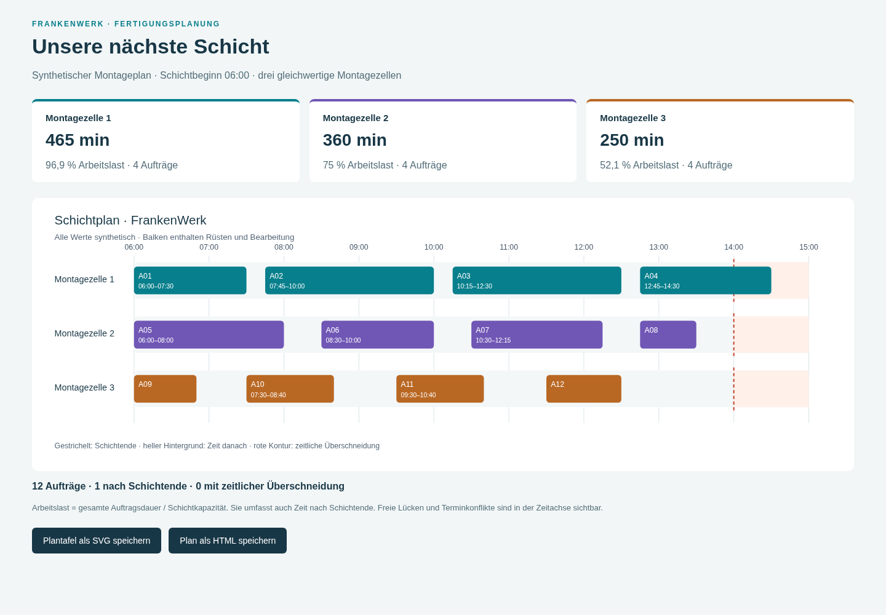

# KINMEathon

Vier Teams bearbeiten parallel jeweils einen deutschen KNIME-Fall in drei Stunden. Story, Aufgaben, Fachregeln, Qualitätschecks und Zusatzaufgaben stehen direkt als farbige Annotationen im Flow.

## Dateien herunterladen

[Alle vier Aufgabenflows als ZIP herunterladen](https://github.com/DannyATPowerBI/KINMEathon/raw/refs/heads/main/downloads/Vier_Uebungsflows.zip)

| Fall | Thema | Workflow |
| --- | --- | --- |
| 1 | Merkmalskombinationen manuell prüfen und eine Historie ergänzen | [Merkmalsprüfung](https://github.com/DannyATPowerBI/KINMEathon/raw/refs/heads/main/workflows/01_Merkmalspruefung_AUFGABE.knwf) |
| 2 | Erzeugte Wetterstunden mit Produktgrenzen und Lieferungen verbinden | [Wetterlogistik](https://github.com/DannyATPowerBI/KINMEathon/raw/refs/heads/main/workflows/02_Wetterlogistik_AUFGABE.knwf) |
| 3 | Montageaufträge als grafische Plantafel darstellen und den Schichtplan verbessern | [Fertigungsplanung](https://github.com/DannyATPowerBI/KINMEathon/raw/refs/heads/main/workflows/03_Fertigungsplanung_AUFGABE.knwf) |
| 4 | Störungsmeldungen priorisieren, zuordnen und fachlich freigeben | [Störungsmeldungen](https://github.com/DannyATPowerBI/KINMEathon/raw/refs/heads/main/workflows/04_Stoerungsmeldungen_AUFGABE.knwf) |

Die Dateien von Fall 1, 2 und 4 sind unverändert. Die [Referenzflows](moderation/) liegen separat; das [Moderationspaket als ZIP](https://github.com/DannyATPowerBI/KINMEathon/raw/refs/heads/main/downloads/Moderation_vier_Referenzflows.zip) enthält alle vier Referenzflows.

## In KNIME starten

1. `.knwf` herunterladen oder das Aufgaben-ZIP entpacken.
2. Über den KNIME-Workflow-Import importieren.
3. Eingabe-Nodes ausführen und die Aufgaben im Canvas lesen.
4. Verarbeitung und Ergebnisansichten ergänzen.
5. Den ausgeführten Workflow einschließlich Ergebnisse als `.knwf` exportieren.

**Alle vier Fälle erzeugen ihre Daten im Flow.** Die Table Creator enthalten vollständig fiktive, wiederholbare Startbestände. Es werden keine zusätzlichen Eingabedateien, API-Zugänge oder Datenbankverbindungen benötigt. Ergebnisse bleiben als Tabellen und Ansichten im Flow; ein Dateiexport ist freiwillig.

Aufgebaut für KNIME Analytics Platform 5.5.1 mit KNIME Base Nodes und KNIME Views. Prüfoberflächen in Fall 1 und 4 verwenden zusätzlich KNIME JavaScript Views und Quick Forms. Die vorbereitete Plantafel in Fall 3 nutzt ebenfalls KNIME JavaScript Views; JavaScript-Programmierung ist für das Team nicht erforderlich. Fall 3 verwendet Math Formula aus KNIME Math Expression (JEP). Die Aufgabenflows enthalten die Daten und Rohdatenansichten; die Referenzflows ergänzen die vollständige Verarbeitung.

## Fall 2 und 3

**Fall 2 – Wetterfest liefern:** Zwölf Lieferungen, drei Produkte und 48 synthetische Wetterstunden. Schwerpunkt: Left Joins, produktabhängige Grenzen, fehlende Werte, Dispoliste und Feuchteverlauf. [Aufgaben und Kontrollwerte](docs/02_Wetterlogistik.md)

**Fall 3 – Unsere nächste Schicht:** Zwölf Aufträge auf drei Montagezellen. Ein Join und zwei Formeln liefern die Daten für eine vorbereitete Gantt-Plantafel. Das Team ergänzt die Arbeitslast je Zelle und verbessert den Plan. Ergebnis: eine grafische Plantafel mit SVG-/HTML-Export und ein Vorher-nachher-Vergleich. [Aufgaben und Kontrollwerte](docs/03_Fertigungsplanung.md)



## Gemeinsamer Ablauf

| Minuten | Aktivität |
| --- | --- |
| 0–15 | Auftrag und Rollen |
| 15–45 | Daten erzeugen, Schlüssel und Datenqualität prüfen |
| 45–105 | Verarbeitung, Regeln oder Prüfoberfläche |
| 105–135 | Ergebnisansichten und Visualisierung |
| 135–150 | Qualitätsprüfung und Maßnahmen |
| 150–165 | Sicherung und Pitch-Vorbereitung |
| 165–180 | Vier Pitches à drei Minuten und gemeinsamer Abschluss |

Vorausgesetzt werden KNIME-Grundkenntnisse. Die Zeitplanung ist eine Schätzung für die jeweilige Teamaufgabe. Die Zusatzaufgaben sind freiwillig.

## Prüfung

```sh
python3 tools/validate_workflows.py
```

Die Prüfung benötigt ausschließlich die Python-Standardbibliothek. Sie kontrolliert Archive, XML, Verbindungen, intern erzeugte Daten, Fachregeln und ZIP-Inhalte. Sie rechnet die neuen Referenzgraphen für Fall 2 und 3 mit einem begrenzten lokalen Prüfmodell nach. [Kontrollwerte und Moderation](docs/Moderation.md)

Die eingebettete Plantafel aus Fall 3 wurde in Chromium mit den berechneten Daten geprüft: Darstellung, SVG-/HTML-Export, verbesserter Plan und der Starthinweis im Aufgabenflow.

**KNIME-Import und native Node-Ausführung wurden hier nicht getestet.** Die Browserprüfung und das lokale Prüfmodell ersetzen diesen Test nicht. Vor dem Termin auf den Teamgeräten importieren, ausführen und die interaktiven Ansichten öffnen.
