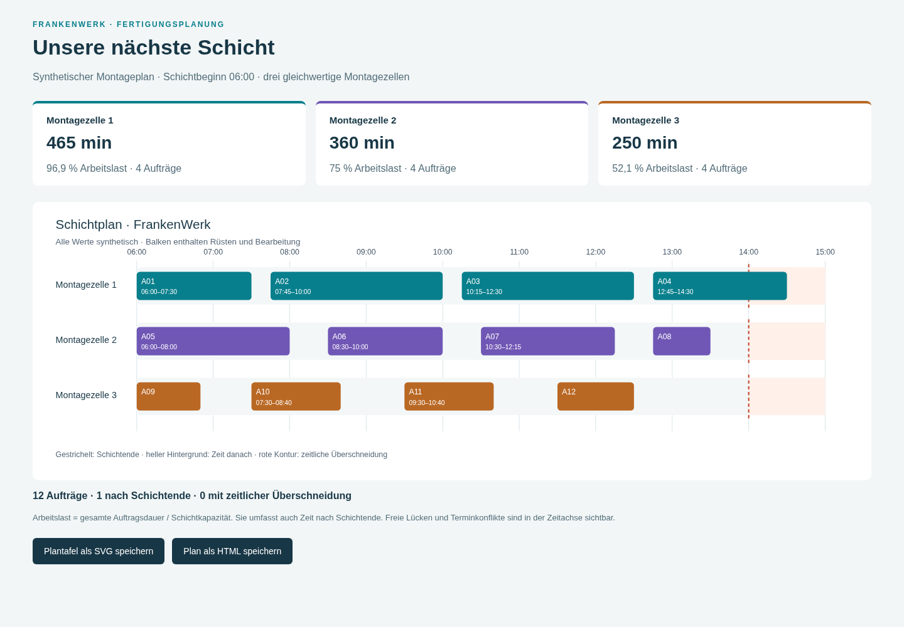

# Fall 3 – Unsere nächste Schicht

Die fiktive FrankenWerk GmbH plant zwölf Montageaufträge auf drei gleichwertigen Montagezellen. Ein Team baut in etwa drei Stunden eine **grafische Plantafel**, erstellt eine Arbeitslastübersicht und verbessert den Plan.

[Aufgabenflow](../workflows/03_Fertigungsplanung_AUFGABE.knwf) · [Referenzflow](../moderation/03_Fertigungsplanung_REFERENZ.knwf)

## Die Aufgabe

Die Schichtleitung braucht einen verständlichen Plan für die Besprechung am Morgen: Welcher Auftrag läuft wann auf welcher Montagezelle? Wo bleiben Lücken? Passen alle Aufträge in die Schicht?

Das Ergebnis ist ein Gantt-Diagramm mit einer Zeile je Montagezelle. Die vorbereitete Ansicht kann die Plantafel als **SVG** und den Plan mit Kennzahlen als **HTML** speichern. Das Team programmiert keine Visualisierung, sondern liefert die berechneten Daten und vergleicht den Ausgangsplan mit einer eigenen Verbesserung.

## Daten im Flow

Zwei Table Creator erzeugen ausschließlich synthetische, wiederholbare Daten:

| Tabelle | Zeilen | Inhalt |
| --- | --- | --- |
| Aufträge | 12 | Auftrag_ID, Produkt, Maschine_ID, Menge, Min_pro_Stueck, Ruest_Min, Start_Min |
| Maschinenstamm | 3 | Maschine_ID, Maschine, Schicht_Min |

Die Schicht beginnt um **06:00** und hat **480 verfügbare Minuten** bis **14:00**. `Start_Min` bezeichnet Minuten ab Schichtbeginn: 90 bedeutet 07:30. Startzeiten und Maschinenzuordnung sind für den Ausgangsplan bereits vorgegeben.

Jeder Auftrag belegt genau eine Montagezelle. Alle drei Zellen sind in dieser Übung gleichwertig; beim Wechsel bleiben Stück- und Rüstzeit des Auftrags gleich. Rüsten zählt pro Auftrag einmal zur Belegungsdauer. Pausen und mehrstufige Arbeitsgänge sind nicht gesondert modelliert.

## Verarbeitung

1. Verbindet Aufträge und Maschinenstamm über `Maschine_ID` mit einem Left Join. Alle zwölf Aufträge bleiben genau einmal erhalten.
2. Berechnet `Dauer_Min = Menge × Min_pro_Stueck + Ruest_Min`.
3. Berechnet `Ende_Min = Start_Min + Dauer_Min` und sortiert nach Maschine und Start.
4. Verbindet die fertige Tabelle mit dem vorbereiteten Node **Plantafel öffnen und exportieren**. Ersetzt seine Verbindung zu den Rohdaten durch eure berechneten Daten.
5. Gruppiert je Maschine: Auftragsdauer summieren und Aufträge zählen. Berechnet `Arbeitslast_pct = Summe_Dauer_Min / Schicht_Min × 100` und zeigt die drei Zeilen als Übersicht.
6. Speichert den Ausgangsplan. Verändert dann Startzeiten oder Maschinenzuordnung im Table Creator und führt erneut aus. Zeigt, wie alle zwölf Aufträge bis 14:00 fertig werden können.

Die Arbeitslast ist die gesamte Auftragsdauer im Verhältnis zur Schichtkapazität. Sie umfasst auch Zeit nach 14:00. Eine Arbeitslast unter 100 % garantiert deshalb noch nicht, dass der letzte Auftrag innerhalb der Schicht endet. Freie Lücken und Überschneidungen sind in der Plantafel sichtbar.

Bei der Verbesserung bleiben alle Aufträge mit ihren Mengen, Stück- und Rüstzeiten erhalten. Auf derselben Zelle dürfen sich Aufträge nicht überschneiden; ein Start vor 06:00 ist nicht zulässig. Eine automatische Reihenfolgeoptimierung ist für die Kernaufgabe nicht erforderlich.

## Vorbereitete Ansicht

Die Plantafel erwartet `Auftrag_ID`, `Produkt`, `Maschine_ID`, `Maschine`, `Start_Min`, `Ende_Min`, `Dauer_Min` und `Schicht_Min`. Im Aufgabenflow zeigt sie zunächst einen verständlichen Hinweis auf die noch fehlenden berechneten Spalten. Sie enthält keine zusätzliche Eingabedatei und ruft keine externen Bibliotheken ab.

- Farbbalken zeigen Start, Dauer und Ende der Aufträge.
- Die gestrichelte Linie zeigt das Schichtende; der Bereich danach ist hell hinterlegt.
- Rote Konturen machen zeitliche Überschneidungen sichtbar.
- Ein Tooltip nennt Auftrag, Produkt und genaue Zeiten.
- Die Exportbuttons speichern SVG oder eine eigenständige HTML-Datei.

Die Quellen der vorbereiteten Ansicht liegen zusätzlich unter [tools/plantafel.js](../tools/plantafel.js) und [tools/plantafel.css](../tools/plantafel.css). Sie sind bereits in beide Workflows eingebettet und werden beim Ausführen nicht aus dem Repository geladen.

## Kontrollwerte für die Moderation

| Montagezelle | Aufträge | Belegungsdauer | Arbeitslast |
| --- | --- | --- | --- |
| M1 | 4 | 465 min | 96,875 % |
| M2 | 4 | 360 min | 75,000 % |
| M3 | 4 | 250 min | 52,083… % |

A01 dauert **90 Minuten**. A04 dauert **105 Minuten** und liegt im Ausgangsplan von **12:45 bis 14:30**. A04 ist der einzige Auftrag nach Schichtende. Es gibt im Ausgangsplan keine zeitlichen Überschneidungen.

Ein einfacher Verbesserungsvorschlag lässt Maschinenzuordnung und Dauer unverändert und schließt nur die drei Lücken auf M1:

| Auftrag | Start_Min bisher | Start_Min verbessert | Ende verbessert |
| --- | --- | --- | --- |
| A02 | 105 | 90 | 09:45 |
| A03 | 255 | 225 | 12:00 |
| A04 | 405 | 360 | 13:45 |

A01 bleibt bei 06:00 bis 07:30. Alle zwölf Aufträge passen anschließend in die Schicht. Die Arbeitslast bleibt unverändert. Der Referenzflow startet bewusst mit dem Ausgangsplan; andere widerspruchsfreie Verbesserungen sind ebenfalls gültig.

## Ablauf und Abgabe

- 0–45 Minuten: Auftrag, Daten und Schlüssel verstehen.
- 45–105 Minuten: Join, Zeitberechnung und Arbeitslastübersicht.
- 105–135 Minuten: Plantafel prüfen und Ausgangsplan speichern.
- 135–165 Minuten: Plan verbessern, vergleichen und Pitch vorbereiten.
- 165–180 Minuten: vier Team-Pitches und gemeinsamer Abschluss.

Abgabe: ausgeführter Workflow, Ausgangsplan und verbesserter Plan als SVG/HTML, kleine Arbeitslastübersicht und zwei begründete Änderungen. Für schnelle Teams: zwei Verbesserungsvarianten vergleichen oder einen weiteren selbst erzeugten Auftrag einplanen.

Die eingebettete Ansicht und ihre Exporte wurden mit den berechneten Daten in Chromium geprüft. KNIME-Import, native Node-Ausführung und die Einbettung der interaktiven Ansicht sind noch auf den Teamgeräten zu prüfen.
